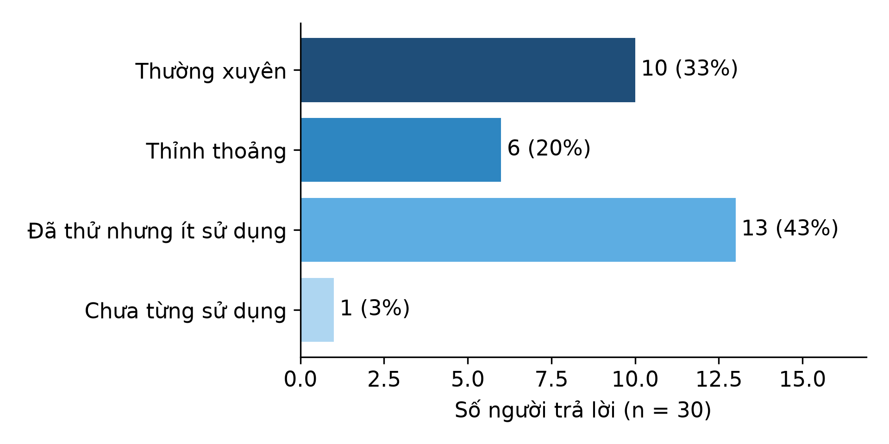

# genai-adoption-it-survey

[](LICENSE)

**Khảo sát mức độ ứng dụng AI tạo sinh trong công việc của nhân sự CNTT**
*(Generative AI adoption among IT professionals – a preliminary survey)*

Tác giả: Lê Thị Mỹ Nhân (M2526010) – Trường CNTT&TT, Đại học Cần Thơ
Học phần: Năng lực số nâng cao

## 1. Giới thiệu đề tài
AI tạo sinh (ChatGPT, GitHub Copilot, Microsoft Copilot, Gemini, Claude…) đang thay đổi cách nhân sự CNTT làm việc. Dự án này khảo sát các vai trò Developer, Business Analyst, Tester/QA, Project Manager, Data Analyst để tìm hiểu mức độ sử dụng, lợi ích cảm nhận và rào cản.

## 2. Mục tiêu
- **RQ1:** Nhân sự CNTT dùng AI với tần suất và công cụ nào?
- **RQ2:** Lợi ích cảm nhận có tăng theo mức độ sử dụng?
- **RQ3:** Rào cản chính là gì?

## 3. Phương pháp
1. Bảng hỏi 15 câu (Google Forms), 5 câu Likert 1–5 đo lợi ích.
2. Phân tích bằng Python (`pandas`, `matplotlib`): thống kê mô tả, Cronbach's alpha, tương quan Spearman.
3. Trình bày kết quả bằng LaTeX (Springer LNCS) và poster A0.

## 4. Kết quả chính
| Chỉ số | Giá trị |
|---|---|
| Số phản hồi | 30 |
| Dùng AI thường xuyên | 33% |
| Cronbach's alpha (thang lợi ích) | 0,852 |
| Spearman ρ (mức độ dùng ↔ lợi ích) | 0,916 |
| Rào cản số 1 | Lo ngại bảo mật dữ liệu (30%) |



> ⚠️ **Dữ liệu là dữ liệu mô phỏng** phục vụ học tập, không chứa thông tin định danh cá nhân. Kết quả chỉ minh họa phương pháp.

## 5. Cấu trúc thư mục
```
genai-adoption-it-survey/
├── data/       # dữ liệu khảo sát (CSV, UTF-8)
├── src/        # mã nguồn phân tích
├── results/    # hình và thống kê sinh ra
├── docs/       # báo cáo PDF, poster
├── LICENSE  CONTRIBUTING.md  CITATION.cff  requirements.txt
```

## 6. Cách chạy
```bash
python -m venv .venv && source .venv/bin/activate
pip install -r requirements.txt
python src/phan_tich_khao_sat.py data/khao_sat_AI_CNTT.csv results/figures
```

## 7. Giấy phép
- **Mã nguồn:** phát hành theo giấy phép **MIT** – xem [LICENSE](LICENSE). Bạn được tự do sử dụng, sửa đổi, phân phối (kể cả thương mại) với điều kiện giữ nguyên thông báo bản quyền và giấy phép.
- **Dữ liệu & tài liệu** (`data/`, `docs/`): cũng phát hành theo MIT trong repo này.

## 8. Trích dẫn
Nếu sử dụng repo, vui lòng trích dẫn theo [CITATION.cff](CITATION.cff) (GitHub hiển thị nút **"Cite this repository"**).

## 9. Đóng góp
Xem [CONTRIBUTING.md](CONTRIBUTING.md).
